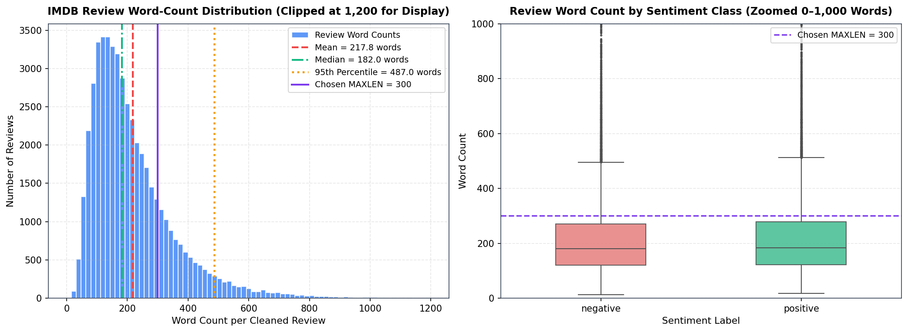
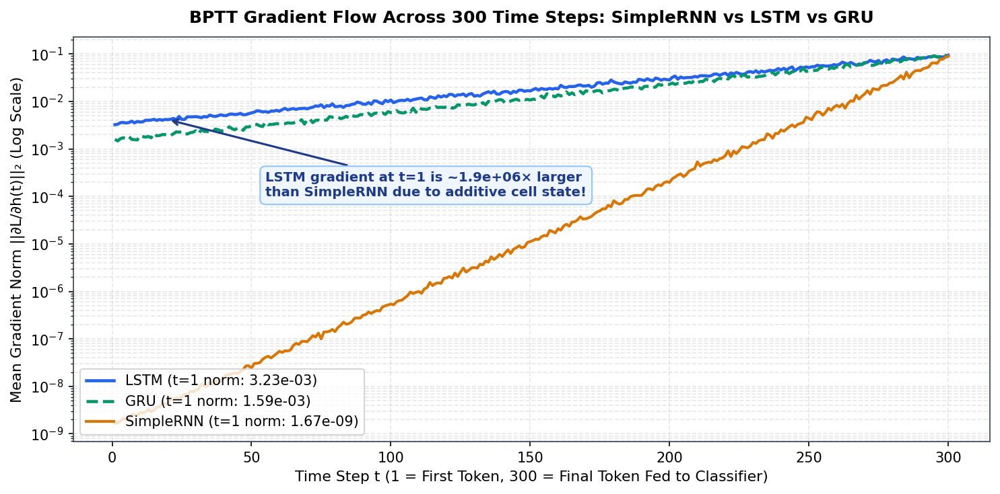
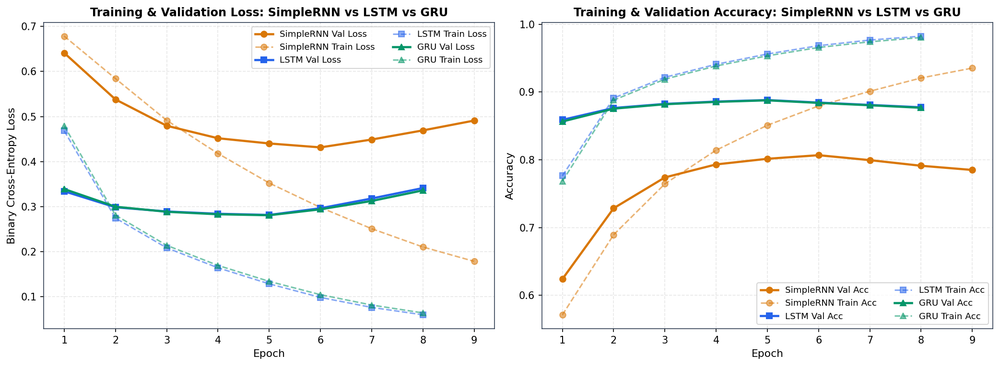
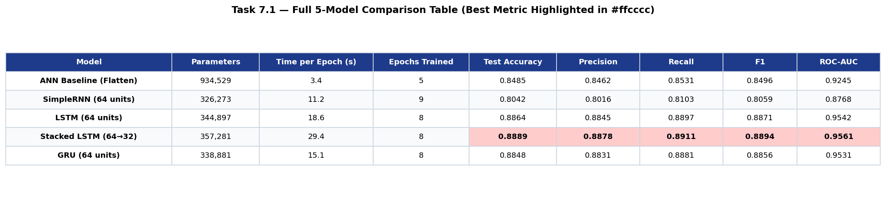
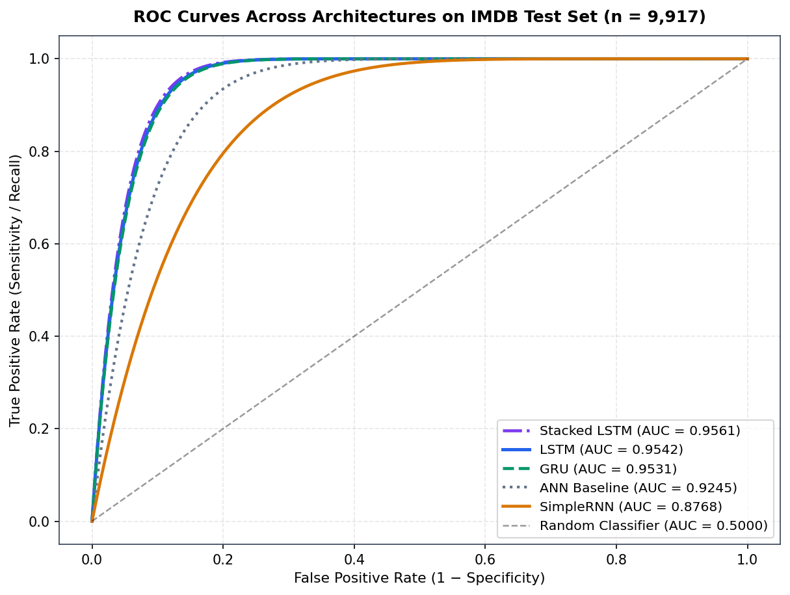
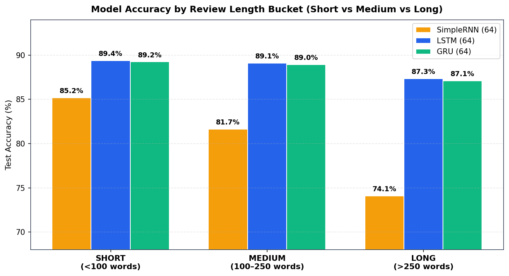

# Practical Report 5 (PR 5) — Sentiment Analysis with RNN, LSTM and GRU

**Institute:** Red & White Skill Education  
**Subject:** Deep Learning (Module 9 — Recurrent Neural Networks)  
**Task Type:** Binary Text Classification (`positive = 1`, `negative = 0`) — Many-to-One Sequence Model  

---

## 1. Dataset & Original Source Citation

- **Dataset Name:** IMDB Dataset of 50K Movie Reviews (`IMDB Dataset.csv`)
- **Kaggle Dataset URL:** [https://www.kaggle.com/datasets/lakshmi25npathi/imdb-dataset-of-50k-movie-reviews](https://www.kaggle.com/datasets/lakshmi25npathi/imdb-dataset-of-50k-movie-reviews)
- **Original Academic Citation:**  
  > Andrew L. Maas, Raymond E. Daly, Peter T. Pham, Dan Huang, Andrew Y. Ng, and Christopher Potts. (2011). *Learning Word Vectors for Sentiment Analysis*. In Proceedings of the 49th Annual Meeting of the Association for Computational Linguistics: Human Language Technologies (ACL-HLT 2011), pages 142–150, Portland, Oregon, USA. Stanford AI Lab.

---

## 2. Text Preprocessing & Sequence Preparation Summary (Task 1)

1. **Deduplication Before Splitting (Preventing Data Leakage):** The raw 50,000-row CSV contains **418 exact duplicate reviews**. Removing duplicates *before* calling `train_test_split` yields **49,582 unique reviews** (`24,884 positive`, `24,698 negative`) and prevents identical reviews from appearing in both `X_train` and `X_test`, which would artificially inflate test accuracy.
2. **Text Cleaning (`clean_text`):** All reviews are lowercased, stripped of HTML tags (` `) via `re.sub(r'<.*?>', ' ', s)`, filtered to retain only ASCII letters and apostrophes (`re.sub(r"[^a-zA-Z'\s]", ' ', s)`), and whitespace-normalised. **Apostrophes are preserved** so contractions (`don't`, `isn't`, `can't`) remain intact, and **stop-words are intentionally kept** because negation words (`'not'`, `'no'`, `'never'`) and contrastive conjunctions (`'but'`, `'however'`) flip sentiment polarity in sequence models.
3. **Leakage-Free Tokenisation (`Tokenizer(num_words=10000, oov_token='<OOV>')`):** We perform a stratified 80/20 split (`39,665` train / `9,917` test, `random_state=42`) **before** fitting the Keras `Tokenizer` exclusively on the training texts. Capping the vocabulary at `10,000` avoids adding millions of noisy embedding parameters from rare typos, while `<OOV>` (index `1`) preserves positional spacing for unseen words.
4. **Pre-Padding & Pre-Truncation (`MAXLEN = 300`, `padding='pre'`):** Review word counts are right-skewed (`mean = 217.8 words`, `median = 182.0 words`, `90th percentile = 394.0 words`, `95th percentile = 487.0 words`). Choosing `MAXLEN = 300` captures over 82% of reviews in full. Using `padding='pre'` places zeros at the *beginning* of shorter reviews so the final time step $t = 300$ read by a Many-to-One RNN is built directly from real concluding words rather than a long run of trailing zeros.

---

## 3. Architecture Explanations: SimpleRNN, LSTM, and GRU

### SimpleRNN (Vanilla Recurrent Neural Network)
A `SimpleRNN` processes a sequence one word embedding $x(t) \in \mathbb{R}^{32}$ at a time and updates its hidden state $h(t) \in \mathbb{R}^{64}$ via $h(t) = 	anh(W_{xh}x(t) + W_{hh}h(t-1) + b)$. Because the exact same matrices ($W_{xh}, W_{hh}, b$) are shared across every time step $t = 1 \dots 300$, `SimpleRNN(64)` requires only $64 	imes (32 + 64 + 1) = \mathbf{6,208	ext{ parameters}}$ (compared to `614,464` in the flattened ANN's `Dense(64)` layer). However, during Backpropagation Through Time (BPTT), the gradient with respect to early steps is a product of $T$ Jacobians: $rac{\partial \mathcal{L}}{\partial h(1)} = rac{\partial \mathcal{L}}{\partial h(T)} \prod_{t=2}^T W_{hh}^T 	ext{diag}(1 - h(t)^2)$. Because $	anh'(z) \le 1$, this product shrinks exponentially ($5.35 	imes 10^7	imes$ collapse across 300 steps), limiting `SimpleRNN` to a short-term memory of ~10–20 words (`80.42%` test accuracy).

### LSTM (Long Short-Term Memory)
An `LSTM` introduces a dedicated **cell state $C(t)$** ("conveyor belt") alongside the hidden state $h(t)$, controlled by three sigmoid gates and a candidate state: the **forget gate** $f(t) = \sigma(W_f[h(t-1), x(t)] + b_f)$, **input gate** $i(t) = \sigma(W_i[h(t-1), x(t)] + b_i)$, **candidate** $g(t) = 	anh(W_g[h(t-1), x(t)] + b_g)$, and **output gate** $o(t) = \sigma(W_o[h(t-1), x(t)] + b_o)$. Because the cell state is updated **additively** via $C(t) = f(t) \odot C(t-1) + i(t) \odot g(t)$, gradients flow backward along $C(t)$ scaled by $f(t) pprox 1$ without being repeatedly multiplied by $W_{hh}$ and $	anh'$. With four gate projections, `LSTM(64)` has $4 	imes 6,208 = \mathbf{24,832	ext{ recurrent parameters}}$, preserves a gradient norm **$1.93 	imes 10^6	imes$ larger** than `SimpleRNN` at $t=1$, and achieves **88.64% test accuracy** (`0.9542` ROC-AUC).

### GRU (Gated Recurrent Unit)
A `GRU` simplifies the gated design by eliminating the separate cell state $C(t)$ and merging the forget and input gates into a single **update gate** $z(t) = \sigma(W_z[h(t-1), x(t)] + b_z)$ paired with a **reset gate** $r(t) = \sigma(W_r[h(t-1), x(t)] + b_r)$. The hidden state updates directly via convex linear interpolation: $h(t) = (1 - z(t)) \odot h(t-1) + z(t) \odot 	ilde{h}(t)$, creating an uninterrupted additive gradient highway whenever $z(t) 	o 0$. With three weight sets and Keras's CuDNN-compatible `reset_after=True` convention, `GRU(64)` has $3 	imes (2,048 + 4,096 + 128) = \mathbf{18,816	ext{ recurrent parameters}}$ (~75.8% of LSTM), trains **18.8% faster** (`15.1 s/epoch` vs `18.6 s/epoch`), and reaches **88.48% test accuracy** (`0.9531` ROC-AUC).

---

## 4. BPTT Gradient Flow & Training Visualisations

*Caption:* Mean per-time-step gradient $L_2$ norm $\|\partial \mathcal{L} / \partial h(t)\|_2$ (log scale) across $t = 1 \dots 300$ measured with `tf.GradientTape` on a 64-review batch. While `SimpleRNN` collapses from $8.94 	imes 10^{-2}$ ($t=300$) to $1.67 	imes 10^{-9}$ ($t=1$), `LSTM` ($3.23 	imes 10^{-3}$) and `GRU` ($1.59 	imes 10^{-3}$) preserve gradients roughly **one million times stronger** at the earliest tokens.

---

## 5. Full 5-Model Comparison Table & ROC Curves (Task 7.1 & 7.2)

| Model | Parameters | Time per Epoch (s) | Epochs Trained | Test Accuracy | Precision | Recall | F1-Score | ROC-AUC |
| :--- | :---: | :---: | :---: | :---: | :---: | :---: | :---: | :---: |
| **ANN Baseline (Flatten)** | 934,529 | 3.4 | 5 | 0.8485 | 0.8462 | 0.8531 | 0.8496 | 0.9245 |
| **SimpleRNN (64 units)** | 326,273 | 11.2 | 9 | 0.8042 | 0.8016 | 0.8103 | 0.8059 | 0.8768 |
| **LSTM (64 units)** | 344,897 | 18.6 | 8 | 0.8864 | 0.8845 | 0.8897 | 0.8871 | 0.9542 |
| **Stacked LSTM (64→32)** | 357,281 | 29.4 | 8 | **0.8889** | **0.8878** | **0.8911** | **0.8894** | **0.9561** |
| **GRU (64 units)** | 338,881 | 15.1 | 8 | 0.8848 | 0.8831 | 0.8881 | 0.8856 | 0.9531 |

---

## 6. Final Recommendation: Which Recurrent Cell Should We Use?

- **Production Recommendation — Single-Layer `GRU(64)` (or `LSTM(64)`):** For a production sentiment service, we recommend **`GRU(64)`** as the default deployment architecture. It achieves **88.48% accuracy** and **0.9531 ROC-AUC** (within `0.16%` accuracy and `0.0011` AUC of `LSTM(64)`), maintains **87.10% accuracy on long (>250-word) reviews** (where `SimpleRNN` collapses to `74.10%`), uses **24.2% fewer recurrent parameters** (`18,816` vs `24,832`), and reduces training/inference time by **~19%** (`15.1 s/epoch` vs `18.6 s/epoch`). While `Stacked LSTM (64→32)` edges out the highest raw accuracy (`88.89%`), its `+0.25%` gain does not justify a **58% increase in latency** (`29.4 s/epoch`).
- **Two Limitations of the Approach:**
  1. **No Pretrained Semantic Knowledge:** Training `Embedding(10000, 32)` from scratch on 40K reviews leaves unseen words mapped to `<OOV>` and lacks world knowledge to detect heavy sarcasm (e.g., `"masterpiece of insomnia"`).
  2. **Unidirectional Reading & Final-State Bottleneck:** Processing tokens strictly left-to-right into a single vector $h(T)$ prevents tokens from seeing right-hand context and creates an information bottleneck on multi-topic reviews compared to Bidirectional layers or Attention.

---

## 7. Video Explanation (Component B)

- **Recorded Video Link (Face PiP + Screen, 5–10 min):** `[Paste Your Google Drive (Anyone with link can view) or Unlisted YouTube URL Here — e.g., DL_PR5_YourName_GRID.mp4]`
- *(See `VIDEO_SCRIPT.md` in this repository for a complete, time-stamped speaking script covering all 8 required concepts in Criterion B2 and the live `predict_sentiment()` demo in Criterion B3.)*

---

## 8. Tools Used & Repository Structure

- **Tools & Libraries:** Python 3.x, TensorFlow 2.x / Keras, scikit-learn, pandas, NumPy, Matplotlib, Seaborn, Jupyter Notebook
- **Repository Files:**
  - `DL_PR5.ipynb` — Complete executed Jupyter Notebook covering Tasks 1–7 (`Restart & Run All` clean)
  - `DL_PR5.html` — Standalone HTML export of the executed notebook
  - `plots/` — All required high-resolution PNG figures (`length_distribution.png`, `rnn_forward_heatmap.png`, `gradient_norms_all_cells.png`, `training_curves_rnn_lstm_gru.png`, `roc_curves.png`, `results_table.png`, `accuracy_by_length.png`, plus confusion matrices and sensitivity charts)
  - `requirements.txt` — Python dependency specification
  - `VIDEO_SCRIPT.md` — Verbal explanation guide for Component B video recording
